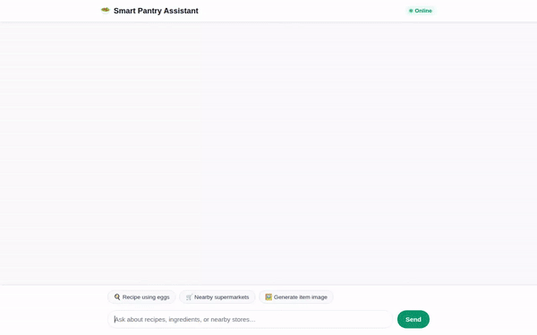

# Smart Pantry Assistant

A smart conversational agent built with Google ADK (Agent Development Kit) and Gemini that helps home cooks track pantry inventory, search recipes, locate nearby grocery stores, generate dish imagery/videos, calculate nutrition via code sandbox, and render interactive A2UI surfaces.



---

## 🌟 Implemented Features & Architecture

### 📦 Pantry Inventory Management (Firestore)
- **Inventory Tracking**: Reads and updates pantry items stored in Google Cloud Firestore (`pantry_items` collection).
- **Expiration Alerts**: Identifies items that are expired or expiring within a configurable threshold of days (`find_expiring_items`).
- **Inventory Updates**: Adds or modifies item quantities, units, categories, and expiration dates (`add_or_update_pantry_item`).

### 🍳 Recipe Search & Grocery Geocoding
- **Recipe Discovery**: Queries external recipe databases via TheMealDB API (`search_external_recipes`) by dish name or ingredient.
- **Geocoding & Nearby Stores**: Converts street addresses into geographic coordinates using Google Maps Geocoding API (`geocode_address`) and finds nearby grocery stores or bakeries via Google Places API (`find_nearby_places`).

### 🖼️ Multimodal Media Generation (Cloud Storage)
- **Dish Image Generation**: Generates dish photos using `gemini-3.1-flash-lite-image` in the `global` region (`generate_pantry_item_image`). Saves image artifacts and uploads them directly to Google Cloud Storage.
- **Recipe Video Generation**: Generates short video clips using Google's Omni model (`gemini-omni-flash-preview`) in the `global` region (`generate_pantry_item_video`). Uploads mp4 bytes directly to Cloud Storage and returns public HTTPS URLs.

### 🧠 Memory Bank & Safety Guardrails
- **User Memory Persistence**: Persists user dietary restrictions, allergies, preferences, and cooking skill levels across sessions using `PreloadMemoryTool` and callback session extraction (`generate_memories_callback`).
- **Allergy Screening**: System instructions strictly enforce checking ingredients against remembered user allergies.

### 🧮 Code Execution Sandbox
- **Nutritional & Portion Calculations**: Executes Python code in a secure `AgentEngineSandboxCodeExecutor` environment to compute nutritional macros, portion conversions, and inventory math.

### 📱 Adaptive UI (A2UI v0.8)
- **Rich Card Layouts**: Renders structured A2UI v0.8 components (Cards, Columns, Rows, Text, Images) via `A2uiSchemaManager` and `a2ui_callback`.

---

## 🛠️ Tech Stack & Google Cloud Services

- **Framework**: Google Agent Development Kit (ADK)
- **Models**:
  - Model: `gemini-2.5-flash`
  - Image Generation: `gemini-3.1-flash-lite-image` (`global` region)
  - Video Generation: `gemini-omni-flash-preview` (`global` region)
  - Background Music: `lyria-002` (Vertex AI)
- **Google Cloud Services**:
  - **Google Cloud Firestore**: Pantry inventory database
  - **Google Cloud Storage**: Public media storage bucket
  - **Google Maps Platform**: Geocoding API & Places API (New)
  - **Agent Engine Sandbox**: Secure code execution environment
- **Frontend**: FastAPI proxy server with custom web client

---

## 🚀 Running Locally

### 1. Prerequisites
- Python 3.10+
- Google Cloud Project with Vertex AI, Firestore, and Cloud Storage enabled
- Authenticated `gcloud` CLI (`gcloud auth application-default login`)

### 2. Environment Setup
Create a `.env` file in the project root:
```env
PROJECT_ID=<your-gcp-project-id>
GOOGLE_MAPS_API_KEY=<your-google-maps-api-key>
THEMEALDB_API_KEY=1
```

### 3. Install Dependencies
```bash
python -m venv .venv
source .venv/bin/activate
pip install -r requirements.txt
```

### 4. Run the Agent Playground
To interact with the agent via the ADK dev UI:
```bash
agents-cli playground app
```

### 5. Run the Custom Web Frontend
Navigate to the `frontend/` directory and start the FastAPI proxy:
```bash
cd frontend
pip install -r requirements.txt
python main.py
```
Open your web browser and navigate to port `8080` to access the chat UI.
